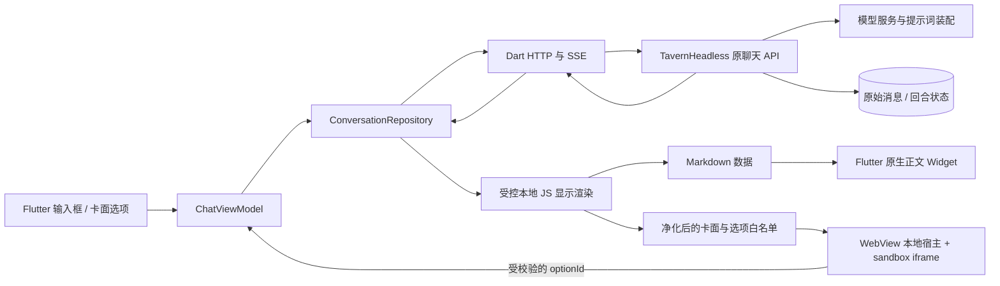

# TavernHeadless Flutter 客户端实施计划

状态：Flutter 技术路线详细设计稿，供下一阶段实现使用。修订日期：2026-10-25。

工作区：`/Users/xiefuzhu/Desktop/Chat/TavernHeadless`。上游基线：`5061b3cc2b0a1007beb59b7943cc61812255b83d`。

正式客户端改为 **Flutter + Dart，仅面向 Android**，拟新建于 `apps/flutter_client`。聊天列表、正文、输入框和设置使用 Flutter 原生 Widget；现有 HTML 行动卡面由受控 WebView 承载。`apps/mobile` 保留为 Vue 网页兼容对照，不再作为正式客户端继续扩展。当前交付为计划修订，尚未创建 Flutter 工程、安装依赖、打包或部署。

平台范围以本次要求为准：**iOS 已取消；只开发和验证 Android**，不保留 iOS 工程、设备、签名或兼容验收任务。

## 1. 规划依据与进入下一阶段的条件

### 1.1 网页原型与后端已有证据

- 后端、原版酒馆与移动原型分别监听本机 3000、8000、5174 端口。
- 当前角色、7 条世界书和夏瑾预设可以完成真实生成；正文与行动选项可以分开渲染。
- 本轮正常 SSE 回复及最后一轮重新生成均得到完整 SUOT，服务端保存原始文本而非显示 HTML。
- 7 个现有测试文件共 116 项通过；多轮实际资产装配诊断通过。
- 实际保存后的预设启用列表与原单角色轨道的 31 项完全一致；不把本地解析通过等同于数据库中的资产正确。
- 本轮修正用户输入正则在装配后的消息序列中计算深度的问题：兼容模式在预设注入和角色合并前处理真实聊天消息，最新输入只处理一次。
- 深度 9 保留正文、10 保留摘要；历史选项移除；7 条世界书命中；没有遗留未展开宏。
- 输出默认已从 4096 改为 65536；导入预设副本上下文默认已改为 1048576。
- 当前模型的实时 /models 元数据返回 context_window=1048576、max_output_tokens=393216，支持目标默认值。
- 本轮补测仅填入、模式切换、普通/整页刷新和 390px 布局；仅填入未增加样本会话楼层，页面无横向溢出。
- 本轮还观察到一次空正文返回。提交保护拒绝该结果并将该轮标记为失败。不能据此宣称模型每次都稳定返回正文。

### 1.2 当前验收边界

以下已有结果属于后端与 Vue 原型，**不能视为 Flutter 运行结果**。可以进入 Flutter 技术验证和分阶段开发；还不能作为正式移动客户端发布。本轮补做了静态样本的刷新恢复与手机宽度检查，生成中刷新、断流和重复点击的整套组合验收仍未完成。实体手机、接近 1M 的输入压力、实际连续输出 64K、长时间后台切换都尚未验收。

以下三类结果必须分别记录：

| 类别 | 通过依据 | 不足以证明通过的情况 |
|---|---|---|
| 资产兼容 | 服务端实际装配、顺序、宏、注入、正则与原版结构对照 | 导入接口返回 201 |
| 模型调用 | 真实请求的结束原因、正文、用量和持久化结果 | HTTP 200 或收到第一个 token |
| 客户端交互 | 实际页面操作、恢复结果、重复提交检查、截图 | 类型检查或构建成功 |

## 2. 产品目标、范围与优先级

### 2.1 目标体验

手机打开 Flutter App，连接自己的酒馆实例，选择角色与匹配的资产组合，创建或继续故事；正文持续显示，生成结束后出现原卡面风格的行动选项。用户能编辑输入、切换仅填入或直接发送、重新生成最后一轮，并在 App 重启或网络中断后回到服务器已经保存的状态。

第一阶段以这套角色卡和预设作为标准兼容样本，实现可维护的 Flutter 客户端模块并消除硬编码资产组合。保留现有卡面的 HTML/CSS 样式，Flutter 负责外层聊天布局、输入与导航。

### 2.2 功能分级

| 优先级 | 内容 | 完成标准 |
|---|---|---|
| P0 | 连接、会话、真实发送、历史、重新生成、两种选项模式 | 主要流程可连续使用，无重复写入和上下文污染 |
| P0 | 1M / 64K 默认、资产绑定、原始消息与显示分离 | 实际请求和服务端装配与页面设置一致 |
| P0 | 异常提示、空结果保护、刷新和断流恢复 | 失败可解释，不覆盖旧回复，不自动补发 |
| P0 | 卡面隔离、来源校验、密钥边界 | iframe 无法读取模型或 API 凭证 |
| P1 | 完整历史分页、草稿恢复、会话搜索与归档 | 长会话可用，切换不丢草稿 |
| P1 | 手机键盘、滚动、长文本性能、诊断面板 | 真机长时间阅读和输入可用 |
| P1 | 后端 HTTPS 部署与 App 远端连接 | 手机可访问自己的实例，SSE 不被代理缓冲 |
| P2 | 主题偏好、离线历史、更多卡面适配 | 在 Android 的 P0 / P1 验收后逐项启用 |

首版不承诺完整酒馆助手 API、EJS、MVU、任意远程脚本、旧聊天迁移、多用户协作、模型直连、Flutter Web 或后台生成续传。发现资产依赖这些能力时应显示具体诊断。

## 3. Flutter 技术栈与工程边界

### 3.1 技术选择

| 层次 | 首选技术 | 使用方式与边界 |
|---|---|---|
| 应用 | Flutter stable + Dart | 仅创建 Android 平台；模拟器与 Android 真机验证 |
| 架构 | MVVM + Repository + Service | Widget 展示；ViewModel 处理交互与不可变状态；Repository 管理服务器事实与缓存 |
| 状态与注入 | ChangeNotifier / Listenable + provider | 构造函数注入；用 Selector/ListenableBuilder 限制刷新范围；首版不同时引入多套状态框架 |
| 导航 | go_router | 连接、角色、会话、聊天、设置与诊断路由；返回行为与会话草稿分离 |
| REST / SSE | package:http | REST 与 POST SSE 共用认证层；流式使用 Client.send 与 StreamedResponse |
| 原生正文 | flutter_markdown_plus | Markdown 转 Flutter Widget；开启选择复制；不承担任意 HTML/JS 渲染 |
| HTML 卡面 | webview_flutter | Android 系统 WebView；只加载受控本地宿主和经过适配的卡面 |
| 访问凭证 | flutter_secure_storage | 选择记住连接时使用平台安全存储；模型密钥始终只在后端 |
| 非敏感偏好 | shared_preferences 的新异步 API | 实例地址、选项模式、字体等；不保存凭证或把它当聊天数据库 |
| 草稿文件 | path_provider + 版本化本地文件 | 按实例/账号/会话/分支隔离；临时文件写入后替换；损坏时可诊断 |
| 显示兼容代码 | 工作区 TS 编译的本地 JS bundle | 复用现有正则引擎与卡面净化逻辑；随 App 打包，不从网络下载执行脚本 |

选择 MVVM 与 Repository 依据 [Flutter 官方架构建议](https://docs.flutter.dev/app-architecture/recommendations)。`provider` 用于注入和有界状态监听，业务状态不放进 Widget 的 build 方法。

当前本机缓存记录显示 `/opt/homebrew/share/flutter` 为 Flutter 3.47.7 / Dart 3.13.5，可作为首轮 SDK 候选；实施时再次核对实际命令路径与工程约束并固定版本。此处未执行 SDK 升级或创建工程。

依赖以工程创建时解析通过的稳定兼容版本为准，提交应用的 pubspec.lock；不在设计稿中把“最新版本”作为不可变约束。最低 Android 版本取 Flutter 与所有锁定插件要求的最高值，并在 M0 确认；同时记录系统 WebView 版本。

参考：[webview_flutter](https://pub.dev/packages/webview_flutter)、[http](https://pub.dev/packages/http)、[flutter_markdown_plus](https://pub.dev/packages/flutter_markdown_plus)、[flutter_secure_storage](https://pub.dev/packages/flutter_secure_storage)、[shared_preferences](https://pub.dev/packages/shared_preferences)。

### 3.2 与现有工作区的关系

- `apps/api` 保留现有 TavernHeadless API 与数据库，模型、提示词、世界书、变量和提交仍由后端管理。
- `apps/mobile` 是 Vue 行为对照与故障复现环境；已有测试记录保留，不冒充 Flutter 验收。
- 新增 `apps/flutter_client` 作为独立 Flutter 应用，使用 pub 工具链；不能通过 pnpm 安装 Flutter 插件。
- `@tavern/sdk` 和 `@tavern/client-helpers` 是 TypeScript 工作区包，Dart 无法直接 import。以现有路由、OpenAPI、SDK 映射与 helpers 源码为协议依据，实现小范围 Dart 接入层。
- 不为 Flutter 新建第二套聊天 API；缺字段时扩展现有契约并核对兼容性。
- 显示正则与 HTML 适配仍有少量 JS 资产构建工作；它们是受控渲染资源，Flutter 页面本身由 Dart 实现。

### 3.3 建议目录

```text
apps/flutter_client/
  pubspec.yaml
  pubspec.lock
  lib/
    main.dart
    app/
      app.dart
      router.dart
      dependencies.dart
    core/
      config/generation_defaults.dart
      network/tavern_api_client.dart
      network/sse_decoder.dart
      network/api_error.dart
      storage/credential_store.dart
      storage/preferences_store.dart
      storage/draft_store.dart
    data/
      services/tavern_api_service.dart
      services/render_runtime_service.dart
      models/                         REST/SSE DTO 与字段解析
      repositories/connection_repository.dart
      repositories/character_repository.dart
      repositories/session_repository.dart
      repositories/conversation_repository.dart
      repositories/render_repository.dart
    domain/
      models/                         不可变会话/消息/生成/面板模型
      use_cases/                      只放真正跨 Repository 的复杂流程
    ui/
      core/                           主题、错误提示、通用组件
      features/connection/
        view_models/connection_view_model.dart
        views/connection_screen.dart
      features/sessions/
        view_models/session_list_view_model.dart
        views/session_list_screen.dart
      features/chat/
        view_models/chat_view_model.dart
        views/chat_screen.dart
        views/message_list.dart
        views/message_item.dart
        views/composer.dart
        views/action_panel_webview.dart
      features/settings/
      features/diagnostics/
  assets/renderer/
    host.html                         受控本地宿主
    runtime.js                        正则/解析/净化 bundle
    panel_host.html                   卡面宿主与 iframe 桥接
    manifest.json                     bundle 版本与来源摘要
  android/
```

Dart 模型初版使用 final 字段、显式 fromJson/copyWith；只在重复代码规模确有收益时再采用生成器。复杂状态可用 sealed class / enum，避免用多个互相矛盾的 bool 表达生成过程。

Repository 是客户端状态的入口，但服务器时间线仍是提交事实来源。Widget 不调用 HTTP、不拼提示词、不直接修改 Repository 缓存。

### 3.4 原生 UI 与 HTML 的数据流



API 访问凭证只存在于 Dart 请求层和用户选择的安全存储。Renderer 与卡面只接收显示所需文本、规则和非敏感归属信息。显示 HTML、Flutter Widget 文本和界面诊断均不写回模型历史。

### 3.5 首先验证的技术风险

1. 官方 WebView 插件在 Android 对本地资产、JavaScript channel、sandbox iframe、CSP 与导航拦截的行为。
2. 当前复杂 lookbehind、替换串及 flags 在目标 Android 系统 WebView 中的执行结果；记录设备、Android 与 WebView 版本，并与网页基线对照。
3. 非可见渲染宿主的 JS 执行与页面生命周期；Offstage 不等于保证后台可执行。
4. Flutter 滚动列表内的平台视图高度、焦点、键盘与手势竞争。
5. HTTP 流取消后服务端任务状态，以及 App 返回前台时的恢复。

这些是 M0 的放行条件。若纯本地 renderer 在目标平台受限，应记录限制并先完成独立 JS runtime 方案评估，不能悄悄改用语义不同的 Dart 正则或把客户端整个换回网页。

## 4. 默认上下文、输出与参数生效规则

### 4.1 精确定义

| 设置 | 默认值 | 语义 |
|---|---:|---|
| 总上下文 | 1,048,576 token | 输入与本次预留输出共同使用的窗口，界面标为 1M |
| 最大输出 | 65,536 token | 单次请求输出上限，界面标为 64K |
| 初始输入预算 | 983,040 token | 1,048,576 − 65,536；包含预设、世界书、历史等全部输入 |
| 单次真实验收回复长度 | 简短场景 | 验证参数接受和交互，无需故意消耗完整 64K |

64K 是允许的上限，不是要求模型每次写满的长度。模型若把推理计入输出用量，推理会占用同一个输出预算。输出上限与中文字符数不能直接换算。

当前 DeepSeek 文档将 context_window 定义为输入与输出总容量；模型列表可提供 context_window 与 max_output_tokens。客户端应显示已验证的模型能力，不能只根据模型名称猜测。

参考：[DeepSeek 模型列表](https://api-docs.deepseek.com/api/list-models/)、[模型规格](https://api-docs.deepseek.com/quick_start/pricing/)、[Chat Completions 参数](https://api-docs.deepseek.com/api/create-chat-completion/)。这些是 2026-10-25 查询到的文档，运行时仍应以实际服务能力及返回错误为准。

### 4.2 当前原型如何生效

- `bootstrap-mobile.py` 只修改导入预设副本的 `openai_max_context=1048576`、`openai_max_tokens=65536`。
- 手机网页发送与重新生成都传入 `generationParams.maxOutputTokens=65536`。
- 后端使用预设上下文预算，输出请求参数覆盖优先级高于预设。
- 原始下载文件和原版酒馆配置不改动。
- 更新预设时核对数据库中的活动启用列表，保留原 31 项的启用顺序。上游 editor 会补齐不在活动轨道中的其他条目，因此必须显式将这些条目设为禁用。

### 4.3 正式客户端参数方案

参数解析顺序定为：本次明确覆盖 → 会话已保存的参数 → 选择的模型配置 → 客户端默认值。界面区分“默认值”“继承值”和“本次覆盖”，恢复默认不等于发送 `null`。

目前 TypeScript 聊天 SDK 的 `RespondGenerationParams` 没有 `maxContextTokens` 字段，聊天请求 schema 也没有对应参数。Dart 新加一个属性并不能让后端自动支持。首版通过现有服务端模型/预设配置兑现上下文；如需单次覆盖，则同时补齐原 API schema、映射、Dart DTO 与 TypeScript SDK 的一致契约。输出使用现有 `generation_params.max_output_tokens=65536`，不建立另一套聊天接口。

设置保存后需调用 dry-run 并核对有效输入预算、预留输出、资产版本和最终生成参数。若参数未被接受或被模型能力裁剪，应显示原因并要求用户调整；不能静默回退到 4K 或其他值。

### 4.4 大上下文的必要约束

- 页面只发送用户本次输入和参数，提示词由后端装配，不上传整套 DOM 或重复拼接全部历史。
- 后端的 token 估算不等于模型精确计数。先核对当前计数器对中文、HTML、宏展开和系统消息的偏差，再决定预留余量与超限处理。
- 1M 是配置目标；接近上限的合成输入必须单独验收，不能用几千 token 的成功请求证明 1M 已经过压力测试。
- 摘要正则仍按原资产深度执行，增大窗口不会自动关闭摘要或改变原提示词行为。
- 固定预设或世界书本身超限时，应拒绝并说明具体来源；不能通过删掉未知规则来让请求表面成功。
- 当前模型调用总超时为 180 秒，不能保证 64K 长输出能在该时间内完成。正式客户端需分别核对模型调用总时限、空闲时限、反向代理时限与 Android 后台策略。
- 长输出总时限需要按实测生成速度确定；上线前用延迟流验证，不直接把所有网络超时无限增大。

## 5. 页面与用户流程

### 5.1 连接页面

显示实例地址、API 访问凭证、玩家名字、连接状态和默认生成预算。首次连接校验地址、认证、API 可用性和资产配置。失败保留用户刚填写的字段，提示认证错误、网络不可达或服务版本不兼容。

Flutter 客户端填写完整实例地址，例如用户自己的 `https://tavern.example/api`。原生 App 没有网页 origin，不能把 `/api` 当作独立 base URL。Android 模拟器与 Android 真机的本机映射分别核对；真机 127.0.0.1 指向手机本身。服务端模型密钥没有对应客户端输入框。

默认可仅在内存保留访问凭证；用户开启“记住连接”时写入 flutter_secure_storage。退出连接停止流观察与轮询、清理内存，并提供移除已保存凭证的动作。非敏感实例地址可以保留。不要把 API Key 放进 URL、日志、截图、诊断导出、JS bundle 或 WebView。

### 5.2 角色库与新建会话

角色列表显示名称、简短描述和兼容状态。新建会话前明确展示角色、预设、世界书、正则、玩家身份、模型配置和默认预算的组合。

当前原型会把同一套夏瑾资产绑定给任何选中的角色。正式客户端必须修正：每个角色有显式可选的资产组合；没有适配组合时不自动绑定夏瑾预设。此项是多角色功能放行条件。

创建成功后进入新会话、读取服务端开场白；开场白的宏与显示正则按同一渲染管线处理。创建失败不把临时会话插入正式列表。

### 5.3 会话列表

显示标题、角色、最近更新时间和生成状态，支持继续、重命名、搜索与归档。移动端采用抽屉或独立列表页，桌面保留侧栏。不要同时占用手机屏幕顶部多行下拉框和大面积设置面板。

归档与删除区分；优先实现可恢复归档。切换会话前保存当前草稿。不同实例/账号的会话 ID、草稿、缓存和认证状态必须隔离。通过 go_router 返回列表时释放当前页面观察者，不把路由 pop 直接解释为服务端取消任务。

### 5.4 聊天页面

顶部放会话名、连接/生成状态与操作入口；中间仅为消息阅读区；底部固定输入区和发送按钮。生成参数、资产版本和兼容说明放在可展开面板中，避免占用日常阅读空间。

输入使用 Flutter TextField / TextEditingController，支持多行与外接键盘 Ctrl / Command + Enter。移动设备按显式按钮发送；检查 TextEditingValue.composing，中文组合输入期间不把 Enter 当作提交。用 FocusNode 管理“仅填入”后的焦点，Controller 不能在 build 中反复创建。生成期间保留复制、阅读与滚动能力，并锁定第二次写入。

### 5.5 行动选项

“仅填入”将选项文本放进当前会话输入框并聚焦，不发出生成请求。若已有草稿，使用可见的替换/撤销行为，避免无提示覆盖长文本。

“直接发送”复用普通输入的同一发送函数，包括空白校验、状态锁、认证、错误处理和草稿记录。生成期间连续点选只允许第一次进入发送流程。

历史面板默认只读。面板所属消息不再是最新可操作回复、会话已切换、回复已被重新生成替换或生成已经开始时，旧面板立即失去发送权限。

## 6. 状态模型、并发与数据一致性

### 6.1 连接状态

```text
未连接 → 连接中 → 已连接
                  ↓
               认证失效 / 网络不可达
```

认证失效不自动删除服务器历史，也不把已有会话视为不存在。网络恢复后重新验证连接，然后核对当前会话。

### 6.2 会话视图状态

```text
未选择 → 加载中 → 可操作
                   ↓
               提交中 → 接收流 → 核对提交 → 可操作
                   ↓        ↓
                 状态不明 → 恢复核对 → 可操作 / 失败待处理
```

重新生成走独立操作状态，但与发送共享写入互斥。列表加载、角色选择、会话切换和恢复轮询应使用明确状态，不能只用一个 `sending` 变量代表所有请求。

### 6.3 操作归属

每个 Dart 异步操作绑定 connectionId、accountId、sessionId、branchId、operationId 和视图 epoch。返回结果与当前归属不匹配时，不得覆盖当前页面。

消息以服务端 floor/page/message ID 为身份；客户端临时消息有独立本地 ID。收到提交结果后通过服务端 ID 对齐，不能按正文相同就去重，否则会误删用户重复发送的合法内容。

ViewModel dispose 时清理监听与恢复定时器，异步回调不继续 notifyListeners；连接与会话切换时使旧 epoch 失效。API 请求被发出但结果不明时，应先查询 active-run 和时间线。当前接口没有验证过通用幂等键支持，因此不能自行添加一个请求头并宣称获得“恰好一次”语义。

### 6.4 写入锁

同一会话的发送、重新生成和会改变当前生成目标的动作共享写入锁。锁在开始异步工作前同步设置，不能等第一个请求返回后才设置。

服务端仍需校验目标是否过期和是否有活动任务。客户端锁只保护本页面，不能替代服务端针对网页对照、第二台设备或其他客户端的互斥。

## 7. Dart API 接入与协议迁移

### 7.1 复用现有 HTTP 契约

| 用户动作 | 现有 HTTP 接口 | Dart 接入职责 |
|---|---|---|
| 列出角色 | GET /characters | DTO、分页、选择与缓存 |
| 会话列表 | GET /sessions | 活动/归档过滤及分页 |
| 创建会话 | POST /sessions | 显式绑定角色、资产、玩家和参数 |
| 读取时间线 | GET /sessions/:id/timeline | active_pages 归一化、排序、分页与去重 |
| 查询生成状态 | GET /sessions/:id/active-run | 启动、前台恢复及流异常核对 |
| 普通发送 | POST /sessions/:id/respond/stream | Dart Stream 接收 SSE，不用 GET EventSource 替代 |
| 最后一轮重生成 | POST /sessions/:id/regenerate | 首版沿用现有非流式返回，再核对时间线 |
| 提示词预览 | POST /sessions/:id/respond/dry-run | 核对预算、顺序、宏和世界书，不调用模型 |
| 读取显示正则 | GET /regex-profiles/:id | 规则来源与版本缓存 |
| 导入资产 | 现有 /import/* | 后续增加原生文件选择，不建立新聊天协议 |

接口路径以当前路由和服务端契约为准，base URL 的 /api 只是部署前缀。保留所有 error.code 和对应状态，不把认证、目标过期、并发冲突都变成一个网络错误。

### 7.2 TypeScript helpers 的 Dart 等价逻辑

对照工作区以下源码移植算法与边界，而非直接加载整个 TS SDK：

- `sdk/src/stream/read-sse.ts`：事件帧解析、JSON 字段与完成结果映射。
- `client-helpers/src/stream/reduce-respond-stream.ts`：流状态 reducer。
- `client-helpers/src/timeline/build-timeline-messages.ts`：active_pages → active_page → pages 中活动项的回退顺序。
- SDK 的 respond/regenerate 参数映射、错误归一化和 usage 解析。

原始 API 使用 snake_case，Dart DTO 显式映射。缺失字段、null、空列表、未知枚举和新增非关键字段分别处理；不能把未知事件直接当作 done，也不能只读取一个 active_page 丢失其他活动消息。

### 7.3 SSE 解析要求

- 使用增量 UTF-8 解码，支持中文或 emoji 字节跨网络分片。
- 按 SSE 帧解析，不把一次 socket chunk 当成一条 JSON。
- 支持 LF / CRLF、空行分帧、多行 data、event 字段、注释心跳与尾部残片。
- 映射已存在的 start、chunk、run、summary、tool、error、reasoning、step_narration、done 事件；正文 chunk、状态和推理事件分开处理。
- 当前 TS helper 不把 reasoning 与中间叙述并入普通正文，Dart 首版保持这一行为并显示必要的生成状态。
- 先识别 HTTP 非成功响应和 JSON 错误，再启动 SSE 解码。
- 收到完成事件仍核对 final_state 与服务器时间线；仅流关闭不代表提交成功。

package:http 的 `Client.send` / `StreamedResponse` 适合这一接入方式。若使用 AbortableRequest，需核对所锁定版本与平台客户端支持；取消本地请求不等于服务端取消成功。生成 POST 禁止透明自动重试。参考 [http 文档](https://pub.dev/packages/http)。

### 7.4 历史分页

当前 TS SDK 默认 limit=200、offset=0。Dart 必须显式定义页大小、最新端定位与向上补页，不照抄这个默认后宣称加载完整历史。核对真实 API 排序和 offset 边界；新回合插入时按稳定 ID 去重并保持阅读锚点。

首版按需手写有限 DTO 和请求方法，不生成一套庞大的未使用客户端；后续可基于固定 OpenAPI 生成普通 REST 模型，但 SSE reducer 与业务语义仍需独立维护。

## 8. 流式输出、重新生成与恢复

### 8.1 发送流程

1. 取得当前连接/会话/分支快照，校验草稿并获取写入锁。
2. 保存可恢复草稿，生成本地操作 ID，显示待确认用户消息。
3. 通过 Dart 请求层调用现有 POST respond/stream；只有该层附加 API Key。
4. 使用对照 TS 语义实现的 Dart reducer 处理开始、增量、警告、结束和错误事件，记录服务端 ID。
5. 正文按固定刷新节奏显示；SUOT 行动片段暂不创建可点击面板。
6. 结束后核对时间线与楼层状态；只为服务端已提交的最新 assistant 回复挂载可操作面板。
7. 成功后清理对应草稿；失败或状态不明时保留操作内容供用户判断，绝不自动重发。

### 8.2 重新生成流程

保留旧回复显示并标记“正在重新生成”。新结果提交成功且服务端确认替换关系后，切换到新回复；旧面板立即失效。

空正文、网络失败、模型拒绝或提交冲突不能导致旧回复消失。当前后端已有空替换保护；正式验收还需验证状态、变量和资产快照不会因为失败候选结果被错误提交。

不要把普通重试楼层接口当成最后一轮重新生成的等价替代。部分上游 retry 接口会清空原输出，选择接口前要核对事务语义。

### 8.3 刷新与断线

App 启动、回到聊天页、通过 AppLifecycleListener 检测 resumed、显式刷新或流异常后，先请求 active-run 与时间线：

| 服务端状态 | 页面行为 |
|---|---|
| 已提交 | 显示服务端结果，移除本地临时流 |
| 仍生成 | 标记恢复中，按有界轮询更新状态 |
| 已失败 | 显示失败原因与已保存输入，允许用户主动操作 |
| 没有活动任务且无对应提交 | 标记请求结果未确认，核对历史后再让用户决定 |
| 无法连接 | 显示离线状态，保留草稿与已加载内容 |

当前服务端可能随着 SSE 连接断开取消生成。第一版接受“恢复已提交结果”的边界，不承诺续接丢失 token；如果用户需要锁屏后继续生成，需要单独实现服务端任务与观察连接的生命周期分离，并为事件游标、取消和重新订阅设计协议。

恢复轮询使用退避、前后台感知、最大等待和显式重试。App 进入后台后不依赖 Dart Timer 持续执行，回到前台必须重新核对服务器。Android 后台限制、进程回收与 WebView 重建都要有清晰恢复路径；首版不借助前台服务维持生成。旧会话轮询不更新新页面，轮询失败不等同于模型失败。

## 9. Flutter 正文、JavaScript 正则与 HTML 卡面

### 9.1 原生正文与显示派生

保存层是服务器原始消息；提示词层由后端执行 prompt 正则；显示层在客户端派生 bodyMarkdown、actionPanels、规则 trace 与诊断。

普通正文由 flutter_markdown_plus 渲染为原生 Widget，不运行内联 HTML/JS。链接点击由 Flutter 决定，默认不自动读取远程图片或本地任意路径；代码块、复制、选择与超长段落单独验收。该包的 Markdown 能力不等于完整浏览器，参考 [包文档](https://pub.dev/packages/flutter_markdown_plus)。

当前网页的 DOMPurify 继续用于 HTML 卡面资产，不能在 Dart 里假装调用 DOMPurify，也不必把原生 Markdown 再转换成浏览器 DOM。

### 9.2 显示正则首选复用本地 JS bundle

本预设包含 lookbehind、flags、JS 捕获组替换与规则通道语义。首版不把这套引擎直接重写为 Dart RegExp；从工作区编译现有 regex-engine 与已知卡面适配逻辑，随 App 打包，在受控本地 WebView renderer 中执行。

渲染服务输入仅含原始单条消息、显示深度、规则快照与明确宏替换数据；不包含 API Key。输出是正文 Markdown、净化后的卡面、选项 ID/文本白名单及诊断。

优先保持一个有界 renderer 实例用于批量显示派生，加上当前可见行动面板的 WebView；避免每条正文都创建原生 WebView。renderer 是否可以在非可见宿主稳定执行，必须在 M0 实测，不把 Offstage、后台或无页面附着当作已保证能力。

若原生 WebView 的 JS 引擎不支持目标规则，应显示具体规则错误并阻止兼容通过。后续选择独立 JS runtime 或提高最低系统版本时要单独评估，不能静默换引擎、删规则或把所有显示正则移到服务器。

### 9.3 兼容语义

- 唯一来源仍为 extensions.regex_scripts，不叠加 SPreset.RegexBinding。
- placement、promptOnly、markdownOnly、启用顺序和深度保持与网页原型一致。
- 深度来自真实聊天消息，最新为 0；Widget 列表顺序、分页显示顺序和系统注入不改变深度。
- renderer 只执行 display 通道；模型上下文由后端处理，显示结果不回写原文。
- 三条来源差异保留在报告；未来来源切换必须互斥且可见。
- 缓存键含 messageId、原文哈希、regexProfileVersion、显示深度与 rendererVersion。
- Android App 的相同输入必须与网页对照逐条比较，特别检查替换串和复杂 lookbehind。

### 9.4 本地 renderer 构建与调用

JS bundle 构建只引入浏览器可用模块，避免把 Node crypto、后端服务或整个 SDK 打进 App。使用既有 pnpm 锁文件构建，Flutter assets 固定打包 host/runtime/manifest，版本变化可以追踪到来源摘要。

通过 rootBundle 与 webview_flutter 的本地资产加载能力使用受控宿主。Dart 调用固定 JS 入口，参数以 JSON 安全编码传递；不直接拼接用户原文到可执行脚本，不用 eval/new Function 执行规则内容。

请求带 requestId / epoch；旧渲染结果到达时丢弃。JSON 与平台通道处理大回复时要分批/分块并核对大小；不把 1M 后端提示词传入 renderer。

复杂规则执行超时必须能恢复：Dart Future.timeout 仅标记等待超时，不能宣称已中止 JS。需要经验证的 Worker 终止或 renderer 销毁重建策略；当前标准资产先建立可重复基线，再开放更多任意规则。

### 9.5 卡面生命周期

生成完成 → 服务端确认 committed → display 正则 → 解析完整 SUOT → 净化 HTML → 生成选项白名单与面板归属 → WebView 本地宿主 → sandbox iframe。

模式、禁用状态与尺寸更新通过受控消息完成，不能每次 setState 就 loadHtmlString。使用稳定 Key 与持有的 Controller，离屏时释放平台视图；历史默认显示原生只读选项或静态内容，不保持大量 WebView。

卡面继续保留原 HTML/CSS，移除原始父 DOM / SillyTavern.getContext() 调用与所有非受控脚本，接入第 10 节桥接。

## 10. WebView → Flutter 桥接与隔离

### 10.1 双层桥接

```text
行动 iframe
  → window.postMessage
受控本地 WebView 宿主
  → JavaScriptChannel 的 JSON 消息
Dart CardBridge
  → ChatViewModel 的统一命令
```

iframe 与本地宿主的通信继续检查 event.source、opaque origin、channel、nonce 和面板归属。Dart 再校验一遍当前连接、账号、会话、消息、panelId、nonce、状态与动作白名单。

**原生 JavaScriptChannel 回调不能直接套用浏览器的 event.source 校验。** webview_flutter 的通用 JavaScriptMessage 提供消息正文，不能默认取得可靠的来源 frame/origin。来源相关平台能力需单独验证，参考 [JavaScriptMessage API](https://pub.dev/documentation/webview_flutter/latest/webview_flutter/JavaScriptMessage-class.html)。

### 10.2 允许动作

| 类型 | 数据 | Dart 处理 |
|---|---|---|
| select | optionId、模式 | 用已登记白名单取回文本，进入统一输入/发送流程 |
| mode | 仅填入/直接发送 | 更新 Flutter 状态与非敏感偏好，通知面板 |
| resize | 有限 CSS 高度 | 约束后换算 Flutter 高度，处理缩放与布局反馈 |
| close | 面板 ID | 关闭当前所属面板，提供原生重新展开入口 |

禁止任意 URL 请求、读取凭证、查询宿主文件、执行 Dart 方法名、任意写变量或直接发模型请求。resize 不允许制造无限高度；连续更新需节流，避免布局循环。

### 10.3 计划中的 JSON 协议

```json
{
  "channel": "tavern-mobile-card",
  "version": 1,
  "panelId": "issued-panel-id",
  "nonce": "issued-by-dart",
  "messageId": "committed-message-id",
  "type": "select",
  "optionId": "option-1",
  "direct": false
}
```

nonce 用 Dart 安全随机源产生，不依赖 WebView 是否支持 crypto.randomUUID。它仅用于面板关联，不是 API Key。Dart 以可信渲染结果登记 optionId → 文本；卡面传来的任意 text 不直接作为发送正文。

发送时还要满足：面板属于当前会话、消息仍是最新已提交 assistant、未被重新生成替换、当前没有写入操作。dispose、切换会话或新一轮开始后立即使旧 nonce/白名单失效。

### 10.4 WebView 安全配置

- 本地宿主才启用最小 JavaScriptChannel；不把整个酒馆网站或任意远程页面加载进这个 WebView。
- HTML 卡面仍在 sandbox iframe 中，保留 allow-scripts，不增加 allow-same-origin。
- 移除导入脚本、事件属性、嵌套外部页面、表单、危险 URL；只注入已审核的桥接。
- CSP 按打包后的本地资产/hash 放行必要脚本与样式，禁止 connect-src、任意外部资源与表单提交。
- 用 NavigationDelegate 拦截导航；但不能把导航回调当作拦截全部子资源网络的保证。CSP 与净化仍必需。
- 卡面不接收 API Key，不设置 Authorization 请求头，不共享认证 Cookie，不获得 Flutter 请求客户端。
- 文件访问、权限请求、弹窗、新窗口、外部 scheme、WebView 调试与平台差异列入真机验收，发布版关闭调试。
- 权限边界依赖“受控宿主 + 净化卡面 + 有限桥接”，不能据此声称支持安全运行任意酒馆助手脚本。

## 11. Flutter 手机布局、生命周期与性能

### 11.1 布局与输入

- 使用 SafeArea、LayoutBuilder、MediaQuery.viewInsets / 文字缩放信息适配布局，不依赖 CSS 媒体查询。
- 覆盖 320、360、390、430、768 logical pixels；开发机上的网页或桌面窗口不替代 Android 真机。
- 输入区跟随软键盘，避免 Scaffold resize 与手动 viewInsets 双重补偿。
- Android 返回键和系统返回手势先处理键盘、面板与路由，返回列表时保持草稿。
- 使用 ListView.builder / SliverList 按需构建消息，稳定 Key 绑定 messageId；文本变化不重建整页。
- 用 SelectionArea / Markdown 选择能力提供复制；宽代码块局部横向滚动，长段落按块处理。
- 支持 TalkBack、文字放大与足够触控面积；卡面内的语义与 Flutter 外层提示共同验收。
- 只在接近底部时自动跟随，向上阅读时保留锚点并显示“回到最新”。

### 11.2 平台视图与卡面性能

WebView 是平台视图，放入滚动列表后需要检查滚动、手势仲裁、裁剪、焦点和高度。不要为每一条历史消息创建 WebView；首版优先保持一个最新可操作面板，历史使用原生只读内容或用户主动展开。

原生消息与 HTML 卡面会有字体度量差异；保留卡面样式不等于整个 App 必须复制网页布局。背景、主题与内容高度在 Android 模拟器和目标真机的 WebView 中分别检查。

渲染服务与面板实例设置数量上限和释放策略；Controller 不在 build 中新建，模式变化不重载页面。App 进入后台不能假定 JS、Dart 定时器或网络一直运行。

### 11.3 64K 输出与长历史

Dart 用 StringBuffer/分块状态累计增量，再按约 50–100ms 合并 UI 更新；避免每个 token 拼接完整长字符串、运行全部正则或 notify 整个聊天列表。

JSON 大对象解析在确有耗时证据时使用 Isolate.run / compute；Flutter WebView 平台调用留在允许的 isolate，不能把插件对象发送到后台 isolate。持久化与解析任务需要有界队列和取消归属。

1M 上下文由后端装配，不要求 App 在一个消息列表中同时渲染 1M token。时间线分页、内存缓存淘汰、长正文分块和流取消是不同任务，分别验收。

### 11.4 性能目标（待测）

| 场景 | 放行目标 |
|---|---|
| 原生输入与仅填入 | 中文输入稳定、焦点正确，WebView 更新不打断输入 |
| 当前行动面板 | Android 布局完整，滚动无明显手势竞争 |
| 200/1000 条历史 | 分页可到最新与最早，无缺口/重复，平台视图数量有界 |
| 合成长输出 | 流式接收时可滚动/复制，结束后与服务器一致 |
| 背景/锁屏/进程回收 | 恢复可解释，不自动重发或显示过期面板 |
| 复杂正则 | 卡住可诊断并重建渲染服务，不持续阻塞原生 UI |

使用 Dart DevTools 记录帧与内存，WebView 资源占用需补充平台观察；当前尚无 Flutter 性能通过记录。

## 12. 错误、诊断与空回复专项

### 12.1 用户可见错误

认证失效、实例不可达、目标已过期、生成繁忙、模型拒绝、超时、正文为空、选项标签未闭合、正则无效、卡面不受支持和恢复失败需有不同提示。错误提示必须说明当前内容是否已经保存，以及用户下一步可以执行什么。

普通错误恢复不自动重发。用户主动重试前先核对服务器时间线；重新生成失败保留旧回复。

### 12.2 空正文诊断

本轮一次正常调用得到空正文，提交保护已生效，但仅凭空文本不能确定原因是推理预算耗尽。下一阶段需采集以下非敏感结构化信息：

- provider 的 finish reason / 请求错误类型。
- 正文字符数、推理字符数、输入/输出 token 数，以及是否有工具调用。
- 请求实际生效的 maxOutputTokens、模型名和客户端操作 ID。
- 流是否正常结束、是否收到完成事件、是否在提交前被取消。
- SSE 与非流式结果映射是否把 reasoning/content 字段处理正确。

完整提示词、正文、推理内容、访问凭证和模型密钥不写入普通诊断日志。需要保留私密复现材料时，放在本机忽略目录并标注用途。

验收需覆盖：正常短回复、重新生成、仅推理无正文、空字符串、空白字符串、网络中断、模型错误。工具执行但没有自然语言的合法结果需与普通聊天空回复区分，避免全局保护破坏其他上游能力。

### 12.3 兼容性诊断面板

按资产显示：格式、导入版本、31 项启用顺序、角色规范化、世界书绑定、7 条命中、规则来源、宏支持、未支持行为和实际生效预算。默认收起，用户需要时可查看。

导出诊断仅包含结构化结果、版本与错误码；默认排除聊天文本和任何密钥。

## 13. Flutter 平台配置、后端部署与分发

### 13.1 原生平台接入

Android 配置网络权限；仅开发目标需要明文 HTTP 时使用受限的 debug 网络配置。正式连接使用 HTTPS，不通过忽略证书验证解决问题。

模拟器与真机分别确认地址映射。后端目前只监听本机，Flutter 真机连接需要后续明确的局域网/服务器接入方案；本次不修改监听或开放公网端口。

macOS 仅作为当前开发机环境；不创建或验收桌面客户端与 Flutter Web。Flutter 工程创建时使用 --platforms=android，仅生成 Android 平台工程。

### 13.2 后端部署

原生客户端通过自己的完整 base URL 连接 TavernHeadless；无需为 App 专门托管 Flutter Web。服务端继续保存模型凭证、资产与数据库，生产反向代理要支持 SSE、正确时限与认证。

部署阶段确认服务器、域名、HTTPS、单实例进程、日志脱敏、备份恢复和手机真实网络。CORS 主要约束浏览器对照页；原生网络不受浏览器 CORS 模型约束，服务端认证仍然必需。

模型能力与已选模型信息由后端以非敏感数据提供；手机不携带模型 Key 请求 provider。

### 13.3 凭证与本地数据

访问凭证按实例与账号保存到平台安全存储；偏好使用 shared_preferences。后者官方明确不适合作为关键数据存储，因此不把它用于聊天事实或唯一草稿保障。

草稿按版本化文件保存，成功提交并核对后再清理。聊天缓存首版以内存为主；离线完整历史与本地数据库作为后续功能，不将本地缓存冒充服务器提交结果。

退出账号/删除连接时分别说明移除凭证、草稿与缓存的范围。Android 安全存储、系统备份/还原与设备数据迁移需要按插件文档验证。

### 13.4 构建与分发

开发阶段先使用 debug 在 Android 模拟器及真机运行。Android APK/AAB、签名与分发作为后续明确的交付动作，当前计划不代表已经执行。

构建时从本地 JS 源生成固定 renderer assets，再构建 Flutter。App 不从远程下载新的执行代码；依赖 pubspec.lock 与 renderer manifest 都进入版本控制。密钥、签名证书和私密 keystore 不入库。

## 14. Flutter 分阶段任务与交付门槛

### M0：Flutter 技术验证与兼容放行

任务：核对并固定 Flutter/Dart；建立仅含 Android 平台的最小 Flutter 工程；验证 Dart POST SSE；移植核心 reducer/时间线规则；加载本地 renderer 与原卡面；验证双层桥接、JS 正则、CSP、导航、面板高度及生命周期。补充原型空正文与恢复诊断。

交付：最小 Flutter 验证 App、插件/平台约束清单、Dart 与 TS 协议对照、Android 模拟器/真机卡面和规则结果。

门槛：Android 模拟器与目标真机均能显示安全正文、渲染原卡面、仅填入/直接发送；复杂规则不丢失；无凭证进入 WebView。若 Android WebView 引擎或非可见 renderer 不满足要求，先解决技术路线，不直接进入大规模 UI 开发。

### M1：Flutter 工程结构、连接、会话与草稿

任务：按 MVVM/Repository/Service 建立模块；provider 注入；go_router 导航；安全凭证；角色/会话列表；显式资产组合；分页；草稿文件；连接/账号隔离与切换竞态。

交付：原生连接、角色库、会话列表、聊天框架、默认 1M / 64K 设置。

门槛：没有 Dart 依赖 TS SDK 的假接入；请求参数与后端生效值一致；旧回调不覆盖新会话；未提交草稿可恢复。

### M2：发送、重新生成与 App 恢复

任务：完整 SSE decoder 与 reducer；统一输入命令；写入锁；完成后核对提交；旧回复候选替换；错误码；AppLifecycleListener；进程重启恢复与退避轮询。

交付：可连续使用的原生聊天流程和异常矩阵结果。

门槛：重复点击只产生一个客户端提交；网络异常不补发；空正文不提交；失败重新生成保留旧结果；后台返回时先核对服务器，不假定续流。

### M3：原卡面、显示正则与兼容诊断

任务：提取可复用 JS assets 构建；display trace；已知卡面适配；双层桥接白名单；关闭/展开入口；版本缓存；未知依赖诊断；Android App 与网页原型对照。

交付：标准角色的 Flutter 兼容报告、renderer manifest、桥接协议。

门槛：31 项启用顺序、7 条世界书、9/10 边界、原始 SUOT 持久化正确；仅填入与直接发送均通过；模式变化不反复重建 WebView；过期面板被拒绝。

### M4：真机、平台视图与长文本

任务：软键盘、安全区域、文字缩放、无障碍、手势、阅读锚点、长历史、流节流、renderer 超时与重建、1M / 64K 边界及后端时限。

交付：Android 模拟器与至少一台 Android 真机的验收、帧/内存记录、已知限制。

门槛：长输出期间输入与滚动可用；WebView 数量有界；网络切换/锁屏/进程回收可恢复；参数上限与调用时限一致。

### M5：服务器接入、构建与分发准备

任务：后端 HTTPS 与 SSE 代理、备份恢复、App 真实网络连接、发布配置和依赖锁定；按实际交付要求准备签名与安装包。

交付：后端部署说明、Flutter 构建说明、设备验收与回滚说明。

门槛：模型密钥只在服务器；访问凭证只在原生请求层/安全存储；发布版 WebView 调试关闭；安装后连接、恢复、卡面功能完整。其他客户端平台不列入本阶段交付。

各阶段按可验证门槛推进，不在平台验证完成前承诺固定开发天数。当前任务只修订计划，不自动开始工程创建、依赖安装、签名或分发。

## 15. 详细验收矩阵

| 编号 | 验收操作 | 预期结果 | 当前证据/后续要求 |
|---|---|---|---|
| C01 | 正确/错误 API Key 连接 | 成功或清晰 401 提示，不泄露凭证 | 原型认证已有证据，正式流程再验 |
| C02 | 修改服务地址并切回 | 会话、草稿与缓存按实例/账号隔离 | Flutter 待实现 |
| C03 | 创建标准角色会话 | 正确资产绑定和开场白 | 已有原型证据 |
| C04 | 选择未适配角色 | 不套用夏瑾资产，显示可配置状态 | 当前缺口，M3 |
| C05 | 正常短消息 SSE | 正文可见、单一提交、完整行动面板 | 本轮真实通过 |
| C06 | 连续点击发送/行动选项 | 同一页面只允许一个写入操作 | 生成锁已见证，整套复测待补 |
| C07 | 仅填入模式 | 输入改变，服务端不新增回合 | 本轮复测通过，样本楼层数不变 |
| C08 | 直接发送模式 | 与普通发送同一流程 | 上轮及当前成功回合有证据 |
| C09 | 最后一轮重新生成 | 成功后替换，失败保留旧回复 | 本轮真实成功；空替换离线通过 |
| C10 | 模型返回空正文 | 显示失败，不提交空聊天回复 | 本轮观察到保护生效 |
| C11 | 用户输入含 SUOT 开标签 | 不误报 assistant 选项截断 | 本轮修正，后续 UI 再验 |
| C12 | 最新用户提示词正则 | 仅真实最新输入按深度执行一次 | 本轮多轮装配通过 |
| C13 | 摘要深度 9/10 | 9 正文、10 摘要 | 引擎与实际资产多轮装配通过 |
| C14 | App 重启/重新进入生成会话 | 不补发；以服务端状态恢复 | 网页恢复有证据，Flutter 待测 |
| C15 | 断开网络并恢复 | 不把本地残片当已提交结果 | 待复测 |
| C16 | App 切后台/锁屏/被系统回收 | 明确继续或取消行为，恢复可解释 | Android 待测 |
| C17 | 旧 WebView/iframe/channel 消息 | Dart 白名单与状态校验拒绝过期操作 | Flutter 双层桥接待测 |
| C18 | App 与网页/第二台设备同时操作 | 服务端冲突可解释，无静默覆盖 | 待测 |
| C19 | 200/1000 条历史 | 可读最新与旧页，无缺口/重复 | 当前默认单页存在缺口，M1/M4 |
| C20 | 320–430 logical pixels 与原生键盘 | 无溢出、焦点稳定、输入/发送可见 | 网页 390px 结果仅为对照，Flutter 待测 |
| C21 | 1M / 64K 参数 | 请求与预算真实生效，不回落 4K | 默认与预算诊断通过，完整压力未测 |
| C22 | 复杂正则/超长 HTML | 可诊断且主页面可操作 | 待实现约束与验收 |
| C23 | 伪造 postMessage/native channel/外部资源 | Dart 拒绝非白名单消息，WebView 无凭证 | Android 动态验收待做 |
| C24 | 原版酒馆对照 | 结构、规则与行为等价范围可解释 | 已有源码/资产对照，完整差异表待补 |
| C25 | 生产部署与重启 | 历史和配置恢复，SSE 可用 | 未部署 |

以上“本轮/已有”结果均指后端和网页原型；Flutter 每项单独记录通过。再增加以下迁移专项：

| 编号 | Flutter 专项 | 放行依据 |
|---|---|---|
| F01 | SSE UTF-8 跨分片、多行 data、CRLF、异常结束 | Dart 解析与已录制协议样本一致 |
| F02 | 多 active_pages 与缺字段回退 | Dart 时间线与 TS helper 相同 |
| F03 | Android WebView lookbehind、flags、替换串 | 同一资产逐规则对照一致 |
| F04 | JavaScriptChannel 缺少通用来源字段 | 双层校验和原生白名单可验证，不能只信 JSON origin |
| F05 | 非可见 renderer 与 WebView 重建 | Android 模拟器/真机可工作、超时可恢复、无旧结果写入 |
| F06 | 键盘、手势、无障碍、文本缩放 | Android 真机有记录 |
| F07 | 凭证存储与退出连接 | Key 不进入 prefs、文件日志或 JS；清理范围正确 |
| F08 | 平台视图与长回复内存 | 数量有界，帧/内存观测符合阶段目标 |

验证命令以所选 Flutter SDK 为准：`flutter analyze`、相关 `flutter test` 和目标 debug 运行；后端保留现有类型检查与相关测试。只改文档时不执行 Flutter 构建或安装依赖。

沿用当前阶段“不新增测试文件”的约定：此轮只修订文档，不新增测试；Flutter 实施初期使用工程现有入口及私密诊断，对 SSE/桥接等关键逻辑扩展可用的已有测试。若后续调整测试文件约定，应在该次实现范围中明确。真机验收必须记录设备、系统、步骤、结果和截图。

## 16. 交付文件与完成定义

| 文件/产物 | 内容 |
|---|---|
| `CLIENT-PLAN.md` | Flutter 技术栈、实现边界、阶段与验收条件 |
| `MOBILE-README.md` | 当前运行方法、默认参数和使用边界 |
| `MOBILE-COMPATIBILITY.md` | 已验证事实、差异、未测/失败项目 |
| `apps/mobile` | 已运行的 Vue 网页对照，不作为 Flutter 实现 |
| `apps/flutter_client` | 后续新建的 Android Flutter 客户端 |
| Flutter renderer assets | 本地 JS bundle、受控宿主与版本 manifest |
| 私密 `.local/` 诊断 | 复现与脱敏检查依据，不公开提交 |
| 后续部署文档 | 仅在 M5 实施后补充实际部署与回滚结果 |

下一步为 M0：先证明 Dart 协议接入和原卡面在 Android 可行，再扩展原生页面。正式“完成”需 Flutter 自身的操作、恢复、兼容、预算、真机布局与凭证隔离证据；网页原型和后端已有通过项不自动转为 Flutter 通过。
